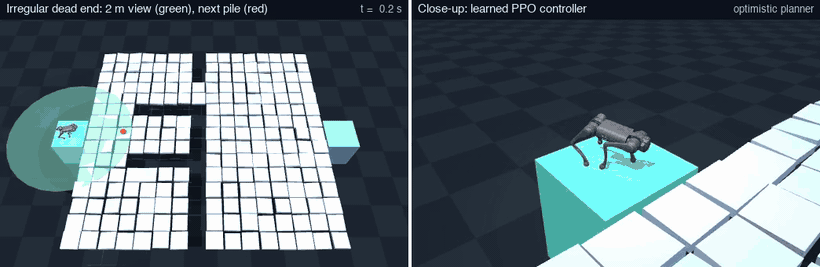
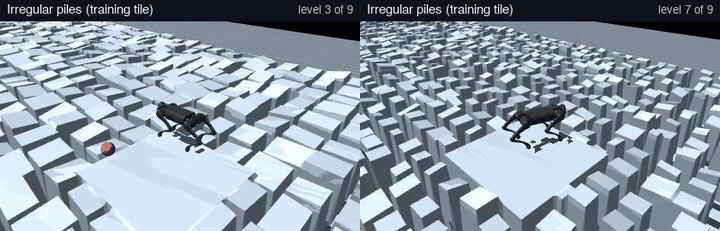
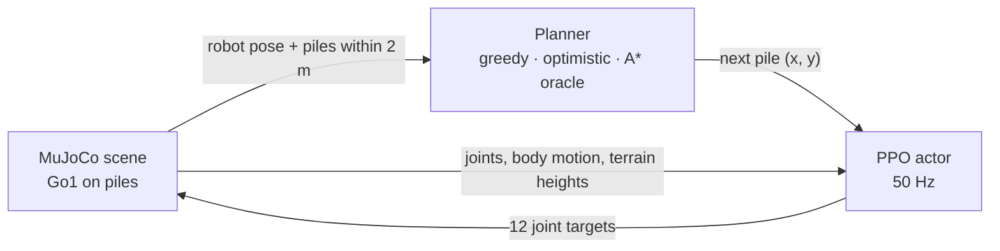
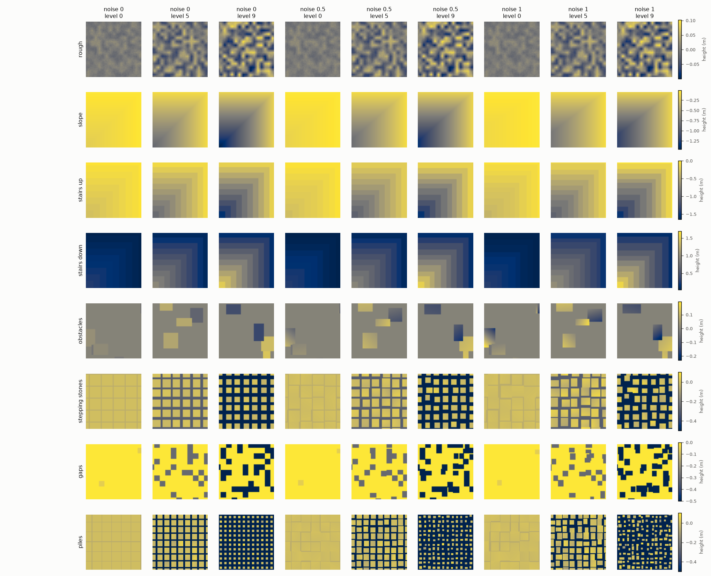
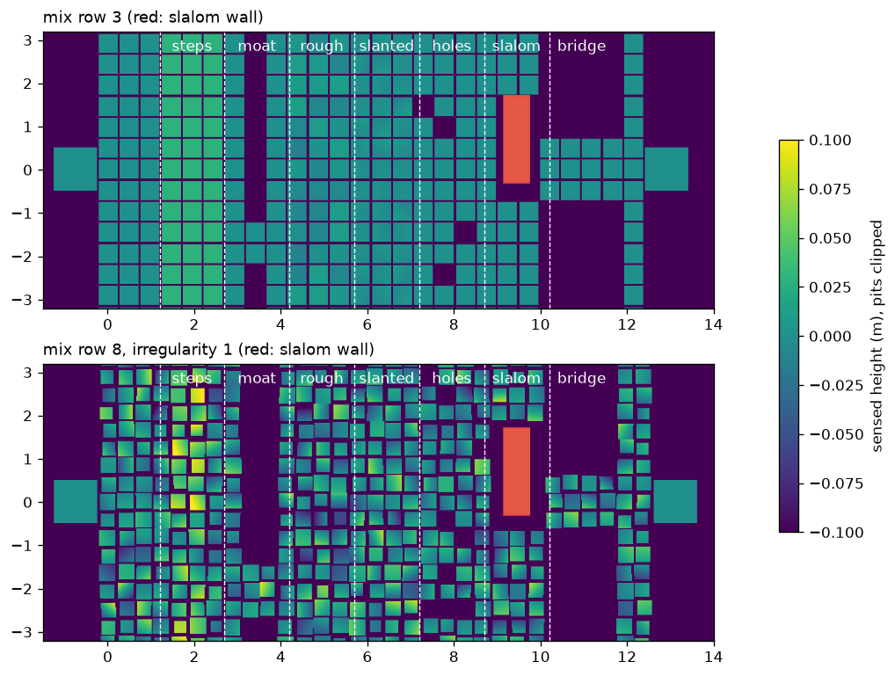
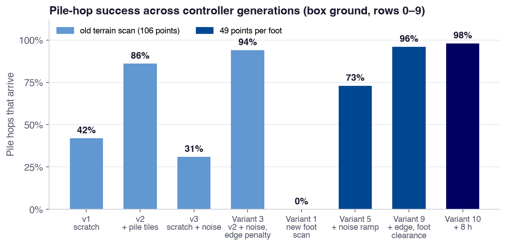
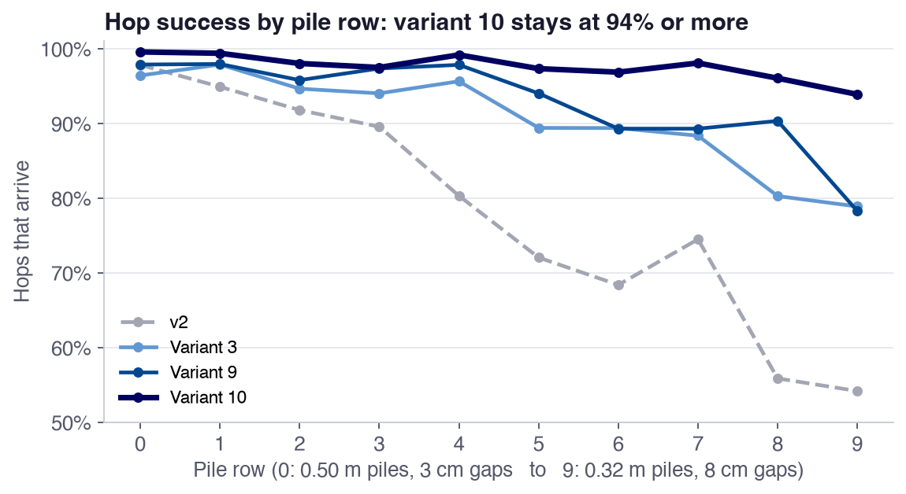
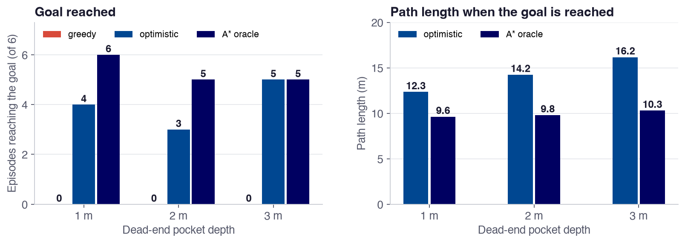

# Quadruped Navigation over Pile Fields with 2 m Perception

A simulated **Unitree Go1** crosses fields of square piles over a 1.2 m-deep pit to reach a goal about 9 m away, while sensing only the terrain within 2 m. A **PPO controller** trained with reinforcement learning walks to subgoals, and a **planner** picks the next pile from what the robot has seen.

KTH DD2600 Robot Learning and Embodied AI, October 2026 · Tanmay Kumar, Amedeo Zaccone

<p align="center">
  
</p>
<p align="center">
  
</p>
<p align="center"><sub><b>Top:</b> optimistic planner + variant 10 controller in an irregular dead-end scene. The green disc is the 2 m view; the red ball is the next pile. <b>Bottom:</b> variant 10 on irregular pile training tiles, levels 3 and 7. The clips use selected seeds; the measured success rates are in <a href="#results">Results</a>.</sub></p>

## Results at a glance

- **98.3%** of 6,732 pile hops arrive with the best controller (variant 10), up from **42%** for the first controller.
- **88.7%** of targets reached on unseen tiles of all 8 training terrains, and **88.0%** on the most irregular version: a loss of only 0.7 points.
- In dead ends beyond the 2 m view, greedy reaches the goal in **0 of 18** episodes, optimistic in **12 of 18** and the full-map oracle in **16 of 18**.
- Training runs on a single KTH H100 GPU slice with up to 8,192 parallel robots, at 35,000–47,000 steps per second.

## How it works



**Planner** (classical, no learning). Each planner may pick only piles that pass a hop rule: inside the 2 m view, at most 2 m away, along a straight line with at most 14 cm of pit and 5 cm of height change under both lines of feet.
- **Greedy:** no memory; takes the allowed pile closest to the goal.
- **Optimistic:** remembers every pile it has seen, treats unseen ground as walkable, and re-plans after each hop.
- **A\* oracle:** sees the whole map; used as the reference.

**Controller** (our own PPO, following the rsl_rl recipe):
- **Inputs (255 values):** joint states, body motion, gravity direction, the target in the body frame plus a guidance velocity, and terrain heights at 49 points around each foot and 4 under the body.
- **Output:** 12 joint position targets at 50 Hz, tracked by PD servos.
- **Actor-critic:** separate 512-256-128 networks. The critic also sees privileged values (body and foot heights above the terrain, time left for the target) and is used only in training.
- **Rewards:** the Lab 1 groups (tracking, goal progress, arrival), penalties for slips, falls and feet near edges, and a foot-clearance term.
- **Training:** random targets 0.4–3 m away on 8 terrain types × 10 levels, with a per-robot curriculum. The planner is used only at test time.

## Terrain design

**Training terrain.** 8 terrain types × 10 difficulty levels: rough, slope, stairs up, stairs down, obstacles, stepping stones, gaps, and piles over 0.5 m pits. Gaussian irregularities perturb each element's size, height, position and tilt. They are switched off on the easiest levels and reach full strength (1.0) by level 4.

<p align="center"></p>

**Navigation scenes.** 10 layout families (open, holes, steps, rough, slanted, slalom, bridge, moat, dead end, mixed) × 20 rows: from row 0 to row 19 the piles shrink from 0.50 m to 0.12 m and the gaps widen from 3 cm to 13 cm. Optional per-pile irregularities change height, tilt, size and position.

<p align="center"></p>

## Results

### Controller generations

Each controller continues training from the one before it (except the ones started from scratch). Each change answers a failure we measured in the previous controller.

<p align="center"></p>

| Controller | Built from | What changed | Pile hops, box ground | Pile hops, height map | Fixed test, regular / noise 1.0 |
| --- | --- | --- | --- | --- | --- |
| v1 | scratch | 7 terrain types, 106-point terrain scan | 42% | 31% | — |
| v2 | v1 | + pile terrain as an 8th type | 86% | 71% | 79% / 76% |
| v3 | scratch | terrain noise 0.5 from the start, 8 h | 31% | 2% | — |
| Variant 3 | v2 | noise 0.5 + edge penalty, 2 h | 94% | 75% | 82% / 80% |
| Variant 1 | scratch | new scan: 49 points per foot, 2 h | 0% | 0% | 52% / 49% |
| Variant 5 | variant 1 | noise ramp, 8,192 robots, 6 h | 73% | 56% | 83% / 82% |
| Variant 9 | variant 5 | + edge penalty and foot clearance, 6 h | 96% | 81% | 88% / 86% |
| **Variant 10** | variant 9 | 8 more hours (heading reward had no effect) | **98%** | **84%** | **89% / 88%** |

<sub>**Pile hops:** a hop arrives if the robot stops within 0.20 m of the chosen pile, in time and without falling; pile-scene rows 0–9, 4 families, 48 episodes per family and row; v1 and v3 were measured on an earlier, smaller set. **Fixed test:** 1,280 robots on unseen tiles of all 8 types, each reaching one target 2 m away within 10 s. Variant 10's lineage trained for 22 h in total.</sub>

<p align="center"></p>

### Planning with a 2 m view

Dead-end scenes put a pocket 1–3 m deep in the straight line to the goal, ending at a moat. The only crossing is off to the side.

<p align="center"></p>

- **Greedy** walks to the end of the pocket and keeps choosing the same piles until it falls or runs out of time.
- **Optimistic** walks in, sees the moat, and walks back out. Its path is 1.28×, 1.45× and 1.57× the oracle's for 1, 2 and 3 m pockets.
- **Oracle:** its two failures were both controller falls within the first 4 s.

<sub>Variant 10, dead-end scenes at row 3 (0.44 m piles, 5 cm gaps), 6 seeds per bar, full MuJoCo physics. Raw episodes: [docs/results/dead_end_sweep_v10.jsonl](docs/results/dead_end_sweep_v10.jsonl).</sub>

### Key findings

- **Train on the terrain you test on.** Adding a pile terrain type raised pile-hop success from 42% to 86%.
- **Terrain noise needs a trained base.** From scratch, noise stalled the curriculum (31% of hops). As a fine-tune it improved success and made the controller robust to irregular terrain.
- **Per-hop reliability compounds.** A 12-hop crossing succeeds 25% of the time at 89% per hop and 78% of the time at 98% per hop.
- **The controller relies on its foot scan.** Replacing the scan with its average drops success on irregular piles from 44% to 3%.
- **High success can hide odd behaviour.** Variants 9 and 10 walk backwards 56–57% of the time, because nothing in the task depends on heading. A heading reward did not change this. A backward-speed penalty (Amedeo's run C) did: that controller walks forwards 96–97% of the time it moves.

**Limitations:** perfect height maps instead of real perception, simulation only, and a small dead-end sample. A learned planner trained by DAgger is implemented but was not trained.

## Reproduce

```bash
uv sync --extra train                 # MuJoCo, MuJoCo Warp, PyTorch
uv run --extra train pytest -q        # tests
```

Watch the released controller, or run a planner episode (CPU):

```bash
python watch.py --checkpoint artifacts/controller_v10/controller.pt --terrain piles --level 3 --terrain-noise 1.0
python play.py --checkpoint artifacts/controller_v10/controller.pt --planner optimistic --family dead_end --row 3 --irregularity 0.5
```

Train on a GPU. Variant 10 is a chain of four runs, each resumed from the previous run's `last.pt`: `kth-variant-1-feet49` → `kth-variant-5-6h-from-1` → `kth-variant-5-edge-clearance-6h` → `kth-variant-10-heading-0.7-8h`.

```bash
.venv/bin/python -m quadruped_nav.train --config configs/kth-variant-10-heading-0.7-8h.json \
    --resume runs/kth-variant-5-edge-clearance-6h/last.pt
.venv/bin/python -m quadruped_nav.train --export runs/kth-variant-10-heading-0.7-8h/last.pt --bundle artifacts/controller_v10
```

Evaluate:

```bash
.venv/bin/python -m quadruped_nav.goal_check --checkpoint artifacts/controller_v10/controller.pt --trials 16 \
    --levels 0 1 2 3 4 5 6 7 8 9 --terrain-noise 1.0                   # fixed test
.venv/bin/python -m quadruped_nav.calibrate --checkpoint artifacts/controller_v10/controller.pt --trials 48 \
    --rows 0 1 2 3 4 5 6 7 8 9                                          # pile-hop table
.venv/bin/python scripts/dead_end_sweep.py                              # planners in dead ends
```

More detail: [training variants](docs/TRAINING_VARIANTS.md) · [runbook](docs/RUNBOOK.md) · [manual](docs/Manual.md) · [viewer commands](docs/VIEWER_COMMANDS.md) · [trained controllers](artifacts/README.md)

## Repository

```text
src/quadruped_nav/rl/    PPO, actor-critic, goal-reaching environment, rewards, terrain grid
src/quadruped_nav/       planners, pile-scene generator, physics evaluation, hop tables
configs/                 training configs for every controller
artifacts/               trained controllers (checkpoint, TorchScript actor, manifest)
scripts/                 plots, clips, dead-end sweep
docs/                    guides, figures and results
```

Contributors follow [AGENTS.md](AGENTS.md). The Go1 model comes from [MuJoCo Menagerie](https://github.com/google-deepmind/mujoco_menagerie/tree/main/unitree_go1) (BSD-3-Clause, license in `assets/unitree_go1/LICENSE`). The PPO recipe, terrain sampling and rewards follow DD2600 Lab 1, [legged_gym](https://github.com/leggedrobotics/legged_gym) and [rsl_rl](https://github.com/leggedrobotics/rsl_rl).
