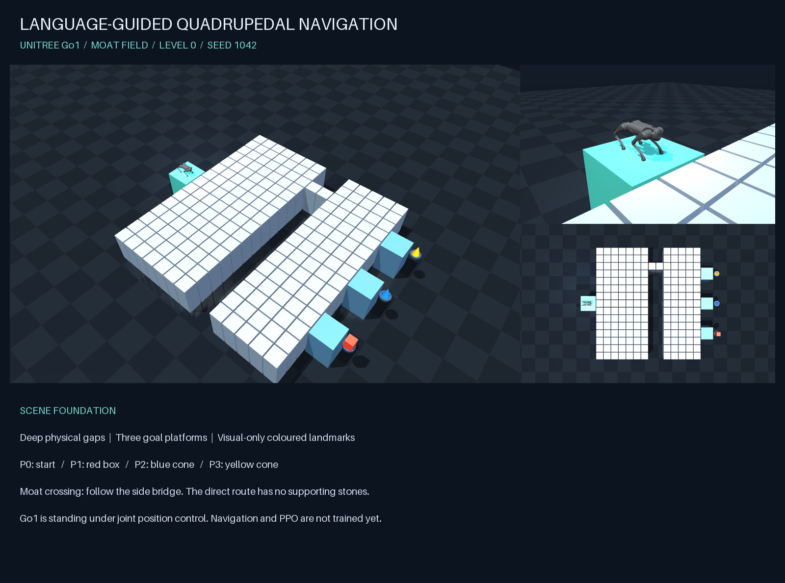

# Language-Guided Quadrupedal Navigation

A MuJoCo environment foundation for a simulated **Unitree Go1**. The current project studies **subgoal planning under partial observability**: a local planner chooses targets for a learned goal-reaching controller. The repository name is retained from the earlier project scope.



## Collaboration and progress

Follow [AGENTS.md](AGENTS.md) for the contributor-branch workflow. Agents push to the contributor's branch and report changes in chat; contributors review and validate the changes, then create pull requests themselves. Check and update [Goals.md](Goals.md) before pushing. Day 1 is October 5, 2026; the project deadline is October 16, 2026.

[Interface examples for team review](docs/INTERFACES.md) describe proposed pile and planner/controller messages. They are drafts, not an implemented API.

## Train in the cloud and run locally

The goal-reaching controller (v3, October 14, 2026) is trained with PPO on the
KTH GPU. 4,096 Go1 robots walk to random targets on 70 terrain tiles: rough,
slopes, stairs up, stairs down, obstacles, stepping stones and gaps, each at
10 difficulty levels, with a per-robot curriculum. The controller then runs
in native MuJoCo on a laptop, where the planners choose its subgoals.
[GOAL_REACHING_V3.md](docs/GOAL_REACHING_V3.md) explains the design and why
the earlier controller only learned to stand still.

- [Runbook](docs/RUNBOOK.md): setup, training, plots, export and local execution commands.
- [Next training runs](docs/TRAINING_NEXT_RUNS.md): step-by-step guide for the v3/v4 runs of RQ1.
- [Implementation status](docs/IMPLEMENTATION_STATUS.md): tested scope and research limitations.

```sh
uv sync --extra train --frozen
uv run --extra train pytest -q
uv run --extra train quad-train --config configs/smoke.json                 # CPU smoke run
.venv/bin/python -m quadruped_nav.train --config configs/kth-goal-v3.json  # GPU run
.venv/bin/python scripts/plot_training.py runs/kth-goal-v3-seed0           # figures
```

Run the planner with a trained controller locally:

```sh
uv run --extra train python play.py --checkpoint artifacts/controller/controller.pt --planner optimistic --family open --row 0
```

Project scene families (planner experiments): flat, open, holes, moat, dead end,
steps, rough heights, slalom walls, narrow bridge and slanted tops. Create a
scene and inspect it with the existing viewer:

```sh
uv run python -m quadruped_nav.terrain --family slalom --row 5 --seed 42
uv run python view.py --scene outputs/terrains/slalom_row5_seed42.json
```

## Abstract simulator and planner replay

Run the Day-1 abstract simulator, evaluate the greedy and full-map A* planners on the same three layouts, and open the replay:

```sh
uv run python simulate.py --open
```

The viewer shows a **light-green 2 m observation circle with a green border** and the **greedy trajectory in blue**. Play, pause, step through decisions, scrub time, switch layouts, and optionally show the full terrain or dashed oracle reference. These overlays are for inspection; the greedy planner receives only its local observation. The marker represents abstract robot position, not animated Go1 locomotion.

`outputs/abstract/replay.html` is a self-contained offline viewer; `outputs/abstract/episodes.json` contains both planners' trajectories, decision observations, masks, outcomes and metrics. Generated runs are ignored by Git and can be reproduced with the command above.

```sh
uv run python simulate.py --family dead_end --level 0 --seed 1042 --open
uv run python simulate.py --scene scenes/open_level0_seed1042.json --target P2
uv run python simulate.py --family open --removal 0.1 --seed 42 --max-gap 0.14
```

The current model uses provisional geometric movement limits and constant speed. It has no trained controller or foot/contact dynamics. The oracle reaches all three default goals; greedy reaches the open-field goal and times out while revisiting piles on the default moat and dead-end layouts. These are deterministic development examples, not calibrated benchmark results. See [abstract model and validation](docs/ABSTRACT_SIMULATOR.md) for assumptions, interfaces and remaining work.

## Earlier scene prototype (still available)

- Three terrain families: **open**, **moat**, and **dead-end**.
- Ten difficulty levels, interpolating the proposal's stone size/gap anchors: level 0 = 46/4 cm, level 5 = 26/9 cm, level 9 = 10/13 cm.
- A 1.2 m deep pit floor, physical stone collisions, one start platform and three goal platforms.
- Three visual-only landmarks: red box, blue cone and yellow cone.
- One JSON scene per layout, used to build portable MuJoCo XML.
- Official Menagerie Go1 meshes, collision geometry and 12 position actuators.
- An interactive viewer, reproducible renders and physics/connectivity checks.

**The original viewer holds a standing pose using joint position servos. Use play.py with a trained checkpoint for planner-driven execution; no language interface is part of the current scope.** This viewer remains useful for scene inspection. No trained locomotion result is claimed.

## Run

Install [uv](https://docs.astral.sh/uv/), then from this folder:

```sh
uv sync
uv run python -m quadruped_nav check
uv run python -m quadruped_nav render
```

Open the interactive simulation on **macOS**:

```sh
uv run python view.py
```

The same launcher works on Linux/Windows. On macOS it starts MuJoCo’s required `mjpython` process and resolves the Python shared-library directory for uv environments. The standalone environment runs on CPU; no NVIDIA GPU is needed for scene inspection. A desktop display/OpenGL context is required for the viewer. On headless NVIDIA Linux, set `MUJOCO_GL=egl` for rendering, or use an available OSMesa backend on CPU.

In the viewer:

| Control | Action |
| --- | --- |
| 7 | Overview |
| 8 | Go1 close-up |
| 9 | Top view |
| Space | Pause/resume |
| R | Reset standing pose |
| Left mouse drag | Rotate camera |
| Right mouse drag | Pan camera |
| Scroll | Zoom |
| Tab / Shift+Tab | Toggle MuJoCo panels |

On macOS you can also double-click **Launch Environment.command**.

## Generate another scene

```sh
uv run python view.py --family dead_end --level 5 --seed 1042
uv run python -m quadruped_nav build --family open --level 3 --seed 42 --removal 0.1
uv run python view.py --scene scenes/moat_level0_seed1042.json
uv run pytest
```

Generated JSON and XML are saved in `scenes/`. Renders are saved in `outputs/` (a new render of the same family replaces its preview). Seed controls random stone removal; canonical scenes with no random removal are intentionally the same geometry across seeds. Open layouts with random removal are **not guaranteed connected**; the `check` command reports absent routes. Connected-layout rejection sampling and train/validation/test manifests remain future work.

## Scene contract

The schema has `seed`, `family`, `level`, `stones`, `platforms`, `landmarks`, `start` and explicit SI-unit parameters. A stone has an ID, centre `(x,y)`, `z_top`, and square `size`. Platform P0 is the start; P1–P3 are targets. Landmarks are simulator metadata and non-colliding visuals; object detection is outside the proposal's scope.

- Core terrain tops are at z=0; pit floor is at z=-1.2 m.
- Stones extend down to the pit floor, leaving real empty gaps between them.
- The moat removes two full stone columns except one bridge at y>=2.5 m, outside the proposed local scan around the direct centreline approach.
- The dead-end field adds side cuts around the direct approach, forming a pocket and forcing a detour.
- Start platform is 1 m wide to safely initialise Go1. Targets are 0.8 m wide. These are initial environment choices, pending controller calibration.
- `geometric_route()` is an A* **connectivity diagnostic** using nominal gap thresholds. It is not an execution-feasibility guarantee, calibrated planner, foothold plan or controller.

## Repository layout

```text
docs/                       Current project proposal and implementation notes
assets/unitree_go1/         Pinned robot model, meshes and original license
src/quadruped_nav/scene.py  Deterministic JSON scene generator
src/quadruped_nav/mjcf.py   JSON → MJCF builder
src/quadruped_nav/simulation.py  Stand controller, render and camera utilities
src/quadruped_nav/abstract.py    Abstract terrain adapter, local observations and movement
src/quadruped_nav/planners.py    Greedy and full-map A* oracle
src/quadruped_nav/experiment.py  Paired episodes, metrics and replay export
src/quadruped_nav/replay.html    Offline interactive replay template
simulate.py                    Abstract experiment entry point
scenes/                     Generated sample layouts and portable XML
outputs/                    Actual MuJoCo renders
tests/                     Geometry, graph connectivity and physics checks
```

## Relationship to the proposal

The current specification is [Project Proposal v2](docs/Project_Proposal_v2.pdf) and the [two-week plan](docs/Two-week%20plan%20subgoal%20planning.md). They supersede the September 30 design retained in `docs/` for historical context. Language grounding and execution-aware edge-cost learning are no longer current deliverables.

The implementation now supplies the controller/planner training and execution pipeline. It uses direct MuJoCo Warp rather than mjlab, elevation-raster sensing rather than runtime ray casting, and a global-batch curriculum. See the implementation status for all differences. Proposed terrain difficulty and abstract traversal limits remain hypotheses to calibrate, not demonstrated robot capability.

## Asset provenance

Go1 is vendored from [Google DeepMind MuJoCo Menagerie](https://github.com/google-deepmind/mujoco_menagerie/tree/main/unitree_go1), commit `4d038b3feae26ec82b46a4d586379114012a8ac7`. Its original BSD-3-Clause license is retained in `assets/unitree_go1/LICENSE`. `UPSTREAM.json` records provenance. Generated scene XML incorporates the model; retain the asset license when redistributing it.
