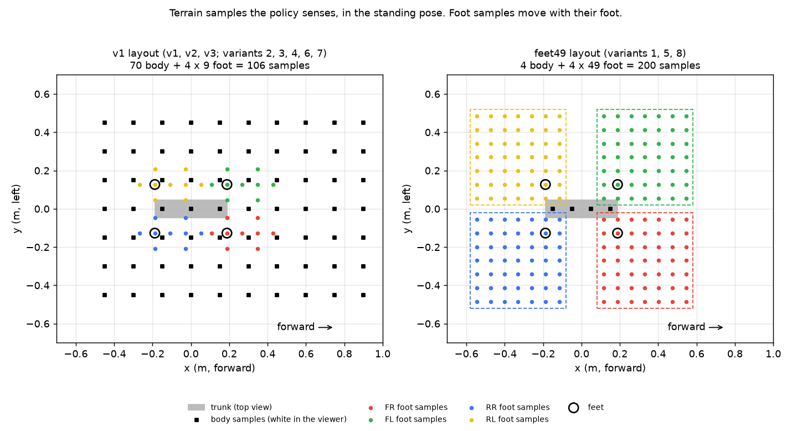
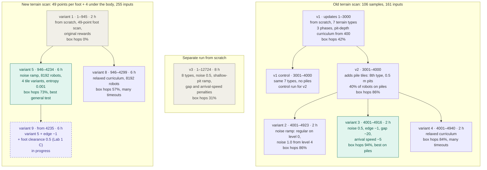

# Eight 2-hour training variants on top of v2

Written October 21, 2026, for the team and for Claude on Amedeo's laptop. Each
variant is one PPO run of 2 hours on a KTH "Medium" GPU, four runs side by side on
each of two GPUs:

| GPU | Variants |
| --- | --- |
| Tanmay's KTH Medium GPU | 1, 2, 3, 4 |
| Amedeo's KTH Medium GPU | 5, 6, 7, 8 |

Everything below is implemented, tested and on branch `tanmay`. Nothing needs to
be coded before training. Background on the training stack and its pitfalls:
[GOAL_REACHING_V3.md](GOAL_REACHING_V3.md). Earlier run guide (v3 from scratch, the
noise table): [TRAINING_NEXT_RUNS.md](TRAINING_NEXT_RUNS.md).

## For Claude on Amedeo's laptop: read first

- **Do not re-implement anything here, and do not edit the variant configs.** Each
  mixed variant must differ from its two parents only in the listed setting (see
  "Which runs answer which question"). A changed value breaks that comparison.
  Tests check every implemented piece (`.venv/bin/python -m pytest -q`).
- **Branch.** Work on Amedeo's branch only if Amedeo asks for code changes (see
  `AGENTS.md`). Training needs only the code at the commit that added this file, or
  any later commit of `tanmay`.
- **Server rules (KTH JupyterHub pod).** 8 CPU cores and 24 GB RAM. Going over the
  RAM limit restarts the whole pod and kills every running training. Keep CPU jobs
  (evaluation) to 5 worker processes or fewer, and run them only after the trainings
  have stopped. Launch long jobs with `setsid nohup ... < /dev/null &` so they
  survive a closed browser tab.
- **Sign-ins.** Never type passwords or tokens for Amedeo. He signs in to the KTH
  hub and GitHub himself.
- **Nothing is committed or pushed** unless Amedeo asks.

## The eight variants at a glance

| # | GPU | Starts from | What changes | Config (`configs/`) | Output (`runs/`) |
| --- | --- | --- | --- | --- | --- |
| 1 | Tanmay | scratch | 49 terrain samples per foot + 4 under the body; original rewards | `kth-variant-1-feet49.json` | `kth-variant-1-feet49` |
| 2 | Tanmay | v2 | regular terrain on level 0, irregularities growing with the level | `kth-variant-2-noise-ramp.json` | `kth-variant-2-noise-ramp` |
| 3 | Tanmay | v2 | v3's noisy terrain again, but from v2; momentum penalty halved; edge penalty | `kth-variant-3-noise-edge.json` | `kth-variant-3-noise-edge` |
| 4 | Tanmay | v2 | relaxed curriculum ("Variant A") | `kth-variant-4-relaxed.json` | `kth-variant-4-relaxed` |
| 5 | Amedeo | scratch | 1 + 2: 49-sample scan with the noise ramp | `kth-variant-5-feet49-noise-ramp.json` | `kth-variant-5-feet49-noise-ramp` |
| 6 | Amedeo | v2 | 3 + 4: noise, halved momentum penalty, edge penalty, relaxed curriculum | `kth-variant-6-noise-edge-relaxed.json` | `kth-variant-6-noise-edge-relaxed` |
| 7 | Amedeo | v2 | 4 + 2: relaxed curriculum with the noise ramp | `kth-variant-7-noise-ramp-relaxed.json` | `kth-variant-7-noise-ramp-relaxed` |
| 8 | Amedeo | scratch | 4 + 1: 49-sample scan with the relaxed curriculum | `kth-variant-8-feet49-relaxed.json` | `kth-variant-8-feet49-relaxed` |

Two optional reference runs, for whichever GPU has room later (each needs another
2 hours on a GPU):

| Ref | Starts from | What it is | Config |
| --- | --- | --- | --- |
| 0 | v2 | v2 trained 2 more hours with the fine-tune settings below and nothing else | `kth-variant-0-control.json` |
| 0s | scratch | variant 1 with the old 106-sample scan | `kth-variant-0-scratch-v1-scan.json` |

Without reference 0, a fine-tune that beats v2 may only have trained longer.
Without reference 0s, variants 1, 5 and 8 can be ranked against each other, but they
cannot show whether the 49-sample scan beats the old one.

"Starts from v2" means `--resume` from v2's checkpoint (update 4000): the weights,
the observation normalizer, the optimizer state and the update counter carry on.
The run's own settings replace v2's.

## Shared settings

### Fine-tunes from v2 (variants 2, 3, 4, 6, 7 and reference 0)

These are the settings of `kth-controller-v3-from-v2.json` with the noise set to 0.
Each variant then changes only what its section says.

| Setting | Value | Why |
| --- | --- | --- |
| terrain types, weights | all 8; v2's mix 1/1/1/1/1/1.2/1/4.8 (40% of robots on piles) | v2's mix: v2 kept its skills on the 7 original types |
| `terrain_noise` | 0 | the regular v1/v2 terrain |
| `terrain_variants` | 2 | two independent tiles per level and type |
| `pile_pit_ramp` | false | 0.5 m pile pits on every level, like the pile scenes |
| `max_start_level` | 9 | robots start on random levels 0-9: v2 already walks there |
| `target_distance` | 0.4-3 m | v1/v2 trained on 1-3 m and never practised the short planner hops (0.25-2 m) |
| rewards | v2's, plus `arrival_speed` -10 and `feet_in_gap` -20 | the two failure-targeted penalties of v3 |
| `entropy` | 0.001 | 0.005 let v3's action noise drift from 1.0 to 1.86 |
| `max_hours` | 2 | the run stops itself after 2 hours |
| `validation_seed` | 100 | the fixed test every 25 updates runs on unseen tiles |

### From scratch (variants 1, 5, 8 and reference 0s)

| Setting | Value | Why |
| --- | --- | --- |
| `scan_layout` | `feet49` (reference 0s: `v1`) | the new observation (variant 1) |
| terrain types, weights | all 8; 8/8/14/10/8/15/12/25 | v3's mix for runs from scratch |
| `terrain_noise` | 0 (variant 5: the noise ramp) | |
| `terrain_variants` | 2 | |
| `pile_pit_ramp` | false | with the ramp, v3's pile robots stayed on shallow pits and then froze over deep ones |
| `max_start_level` | 2 | start on easy tiles |
| `target_distance` | 0.4-3 m | as above |
| rewards | **original rewards**: v1/v2's weights, with `feet_in_gap`, `feet_edge` and `arrival_speed` written as 0 in the config | so the run never depends on the defaults in `rewards.py` |
| `entropy` | 0.005 | v1's value; a run from scratch needs exploration, and the drift of v3 came after hours |
| `max_hours`, `validation_seed` | 2, 100 | |

## Each variant in detail

### Variant 1: 49 terrain samples per foot (from scratch)

**Idea.** The policy senses the terrain around each foot densely: a 7 x 7 grid in a
0.5 m square per foot, plus 4 samples under the body. That is 200 samples in total,
the most the scan may have.



**Geometry** (`SCAN_LAYOUTS['feet49']` in `src/quadruped_nav/rl/config.py`):

- Samples sit 0.5 / 7 = 7.1 cm apart. Each foot's grid moves with that foot and
  turns with the body's heading (the yaw-aligned frame), like the old foot samples.
- Each square is turned away from the body: front feet look ahead, rear feet behind,
  left feet left, right feet right.
- The foot sits on the second sample from the square's inner corner, one sample on
  the body side and five outside. So the foot is not at the centre of its square,
  and one sample is always directly under it.
- In the standing pose (feet at x = ±0.188 m, y = ±0.127 m) the four squares do not
  overlap. They are 16 cm apart lengthwise and 4 cm sideways, and together cover
  1.16 m x 1.04 m. While walking, the squares move with the feet, so two of them can
  briefly touch or overlap during a stride.
- The 4 body samples lie on the trunk's centre line at x = -0.15, -0.05, 0.05 and
  0.15 m. They fill the gap between the squares.

**Values.** These are the same as the old scan:
- foot samples: foot height minus terrain height, clipped to ±1 m;
- body samples: base height - 0.30 m - terrain height.

The actor observation grows from 161 to 255 values; the critic's grows from 167 to 261.

**Why from scratch.** v2's first layer has 161 inputs and this observation has 255,
so v2's weights cannot be loaded. `train.py` refuses to resume across scan layouts
with a clear error. Variants 5 and 8 start from scratch for the same reason.

| | old scan (`v1`) | `feet49` |
| --- | --- | --- |
| samples | 70 body + 4 x 9 foot = 106 | 4 body + 4 x 49 foot = 200 |
| spacing near the feet | 8 cm, 9 samples per foot | 7.1 cm, 49 samples per foot |
| furthest look-ahead from the base | 0.90 m | about 0.58 m (front squares) |
| behind and beside the robot | 0.45 m | about 0.58 m behind, 0.52 m beside |

**What to expect.** Four runs share one GPU's compute, so each gets at most about a
quarter of it. v3 alone did 12,724 updates in 8 hours, about 3,200 in 2 hours, so
each run here should get roughly 800 updates (the 200-sample scan costs a little
more). v1 needed about 3,000 updates for its first phase, so variants 1, 5 and 8 will
be well below v2 after 2 hours. Judge them by their learning curves (and against
reference 0s if it is run), not against v2.

**Risk.** The front squares see only about 0.39 m ahead of the front feet, against
0.9 m ahead of the base with the old scan. At 1 m/s that is under half a second of
look-ahead.

### Variant 2: regular terrain first, irregularities growing with the level (from v2)

**Idea.** Robots meet the irregularities as the curriculum promotes them. They start
on regular or nearly regular tiles, and the irregularities appear early (from
level 1).

**Settings.** `terrain_noise` 1.0, `terrain_noise_ramp` 4, `max_start_level` 2. The
noise on level L is 1.0 x min(1, L / 4):

| Level | 0 | 1 | 2 | 3 | 4-9 |
| --- | --- | --- | --- | --- | --- |
| noise | 0 (regular) | 0.25 | 0.5 | 0.75 | 1.0 (v4's irregularities) |

The noise scales Gaussian deviations of every terrain element: width, length,
height, centre shift, tilt, risers and treads, hole size, slopes. The table of
standard deviations at noise 1.0 is in
[TRAINING_NEXT_RUNS.md](TRAINING_NEXT_RUNS.md). Rough ground is unchanged. Robots
start on levels 0-2; v2 is promoted quickly through the easy levels. In about 800
updates (about 19 episodes of 20 s per robot) a robot promoted every episode reaches
level 9 within the first half of the run.

**Implementation.** `TerrainGrid.level_noise()` in
`src/quadruped_nav/rl/terrain_grid.py`; the setting is `env.terrain_noise_ramp`
(0 = the same noise on every level). Level 0 is exactly the regular tile.

### Variant 3: v3 again, but from v2, with a smaller momentum penalty and an edge penalty (from v2)

**Idea.** Fine-tune v2 on the noisy terrain of v3 (noise 0.5 on every level) instead
of training from scratch. Halve the penalty for arriving fast, and penalise feet
standing at an edge.

**Settings.** `terrain_noise` 0.5, and these rewards:

| Weight | Value |
| --- | --- |
| `arrival_speed` | -5 (was -10) |
| `feet_in_gap` | -20 |
| `feet_edge` | -1 (new) |

The rest is the shared fine-tune settings, which makes this
`kth-controller-v3-from-v2.json` with the reward changes and a 2-hour budget.

**Momentum penalty** (`arrival_speed`). On arrival it pays weight x (speed -
0.5 m/s)², once per target reached. At -5, arriving at 1.5 m/s costs 5, half the
+10 arrival bonus (at -10 it cancelled the bonus). At 1.0 m/s it costs 1.25.

**Edge penalty** (`feet_edge`, item H of the earlier list):
- The terrain is sampled at the foot centre and at 8 points on a 5 cm circle around
  it (`EDGE_RADIUS`).
- A foot counts as standing when its sole is within 2 cm of the highest of these 9
  samples, the same 2 cm as the contact test.
- A standing foot is at an edge when the lowest sample is more than `edge_drop`
  (5 cm) below its sole. This includes a foot whose centre already hangs over the
  drop.
- The penalty is -1 per foot at an edge per second. For scale, tracking the commanded
  velocity pays up to +1.5 per second.
- On a 0.30 m pile (row 9), a foot is free of the penalty in the central
  0.20 m x 0.20 m; on a 0.5 m pile (row 0), in the central 0.40 m x 0.40 m.
- Stair edges deeper than 5 cm count too.
- The idea is the `feet_edge` term of Extreme Parkour (Cheng et al., 2023).
- Code: `_reward_feet_edge()` in `src/quadruped_nav/rl/rewards.py` and
  `GoalEnv._edge_drop()` in `src/quadruped_nav/rl/env.py`. It is off by default.

**Why.** In 10 of 12 v2 falls on pile scenes a foot slipped into a gap. The gap
penalty acts once the foot is in the gap; the edge penalty acts one step earlier,
while the foot still stands on the edge.

### Variant 4: relaxed curriculum, "Variant A" (from v2)

**Idea.** Keep robots on hard levels while they are still learning, as Zhang et al.
(2024) do. Under the old rule, any fall demoted a robot, and every v2 pile robot
ended on level 0.

**Settings.** `curriculum_rule` "relaxed"; everything else is the shared fine-tune
settings, with regular terrain.

| At the end of an episode | strict (v1, v2, default) | relaxed |
| --- | --- | --- |
| promote one level | at least 2 targets reached, at least 80% of the attempted targets, and no fall | at least 2 targets reached and at least 60% of the attempted targets; a fall counts as one failed attempt |
| demote one level | any fall, or no target reached | only without progress: no target reached **and** never closer than 3/4 of the distance to any target (less than a quarter of the way closed) |
| otherwise | stay | stay |

Examples under the relaxed rule:
- 3 of 5 targets: up.
- 2 targets, then a fall (2 of 3): up.
- No target, but half the distance closed before a fall: stay.
- No target and 10% closed: down.

**Implementation.** `GoalEnv._update_levels()` and `episode_progress` in
`src/quadruped_nav/rl/env.py`; constants `RELAXED_PROMOTE = 0.6` and
`RELAXED_DEMOTE_PROGRESS = 0.25`.

### Variant 5: variant 1 + variant 2 (from scratch)

The 49-sample scan with the noise ramp: `scan_layout` "feet49", `terrain_noise` 1.0,
`terrain_noise_ramp` 4, robots starting on levels 0-2. Everything else is identical
to variant 1, including the original rewards. It starts from scratch because v2's
weights do not fit the 255-value observation.

### Variant 6: variant 3 + variant 4 (from v2)

Variant 3 with the relaxed curriculum: noise 0.5, `arrival_speed` -5, `feet_in_gap`
-20, `feet_edge` -1, `curriculum_rule` "relaxed".

### Variant 7: variant 4 + variant 2 (from v2)

The relaxed curriculum with the noise ramp: `curriculum_rule` "relaxed",
`terrain_noise` 1.0, `terrain_noise_ramp` 4, robots starting on levels 0-2. It is
variant 2 with the relaxed rule.

### Variant 8: variant 4 + variant 1 (from scratch)

The 49-sample scan with the relaxed curriculum. It is variant 1 with
`curriculum_rule` "relaxed", and starts from scratch.

## Which runs answer which question

Each pair below differs only in the listed setting. A script check confirmed this
for every pair.

| Question | Compare | Differs only in | Same GPU? |
| --- | --- | --- | --- |
| Does the relaxed curriculum help a run from scratch? | 1 vs 8 | `curriculum_rule` | no |
| Does the noise ramp change a run from scratch? | 1 vs 5 | noise 1.0, ramp 4 | no |
| Does the relaxed curriculum help with the noise ramp? | 2 vs 7 | `curriculum_rule` | no |
| Does the relaxed curriculum help with noise and the edge penalty? | 3 vs 6 | `curriculum_rule` | no |
| What does the noise ramp cost or give with the relaxed curriculum? | 4 vs 7 | noise 1.0, ramp 4, start levels 0-2 | no |
| What do noise 0.5 + edge + halved momentum penalty do with the relaxed curriculum? | 4 vs 6 | noise 0.5, `arrival_speed` -5, `feet_edge` -1 | no |
| Does a variant beat simply training v2 longer? | 2, 3, 4, 6, 7 vs reference 0 | the variant's change | either |
| Does the 49-sample scan beat the old scan? | 1 vs reference 0s | `scan_layout` | either |

Every pair runs on two different GPUs, so the runs may reach different update counts
in their 2 hours. Compare them at the same update:
- numbered checkpoints `update_XXXXXX.pt` are saved every 250 updates (fine-tunes
  count on from 4000: 4250, 4500, ...);
- the validation test runs every 25 updates (`evaluation.jsonl`).

Use the last update both runs of a pair reached. Each variant is one run with one
seed, so differences of less than about 5 percentage points may be chance.

## Step by step on each GPU server

Run these in a JupyterLab terminal in the repository folder. On Tanmay's server
that is `cd "$HOME/RL&EAI/Project/Language-Guided-Quadrupedal-Navigation"`.

### 1. Get the code

Tanmay's server already has the repository on branch `tanmay`. GitHub sign-in with a
password does not work there, so use one of these:

- **A git bundle**, which needs no sign-in. On the laptop, in the repository:
  `git bundle create ../code_update_variants.bundle 78aabed..tanmay`. Upload the
  file to the server's home folder with JupyterLab's upload button, then on the
  server:
  ```sh
  git pull ~/code_update_variants.bundle tanmay
  ```
- **A personal access token.** Tanmay creates a fine-grained, read-only GitHub
  token and types it himself at the password prompt of `git pull origin tanmay`.
  Never store it with `credential.helper store` on the shared server.

Amedeo's server needs a fresh copy:

- **Clone**, if his GitHub account can read the repository; he types his own
  token:
  ```sh
  git clone -b tanmay https://github.com/TanmayKumar-EngStud/Language-Guided-Quadrupedal-Navigation.git
  ```
- **Or from a full bundle** made on Tanmay's laptop with
  `git bundle create ../repo_tanmay.bundle tanmay` and uploaded to Amedeo's home
  folder:
  ```sh
  git clone -b tanmay ~/repo_tanmay.bundle Language-Guided-Quadrupedal-Navigation
  ```

Then check that `configs/kth-variant-5-feet49-noise-ramp.json` exists and
`git log --oneline -1` shows the commit that added this file, or a later one.

### 2. Environment and tests

```sh
bash scripts/cloud_setup.sh          # installs uv if needed, uv sync --extra cloud, CPU/GPU check, 3-update GPU run
.venv/bin/python -m pytest -q        # all tests must pass
```

### 3. v2's checkpoint (fine-tunes only)

The fine-tunes resume from v2's bundle checkpoint, `artifacts/controller_v2/controller.pt`
(update 4000, SHA-256 `3a75bbdd0875e1aa0cc98dc65f39ca4f70552d644c530ea402d832a1f7aea9f0`).

- On Tanmay's server: if `artifacts/controller_v2/controller.pt` is missing, unzip
  `artifacts/controller_v2.zip` there. If that is missing too, use
  `runs/kth-controller-v2/update_004000.pt`, which is the same update.
- On Amedeo's server: upload `controller_v2.zip` (6.5 MB, from Tanmay's
  `artifacts/` folder) into the repository's `artifacts/` folder, then unzip it.

```sh
mkdir -p artifacts/controller_v2 && unzip -o artifacts/controller_v2.zip -d artifacts/controller_v2
.venv/bin/python -c "import hashlib, json; d='artifacts/controller_v2'; m=json.load(open(d+'/manifest.json')); print({n: hashlib.sha256(open(d+'/'+n,'rb').read()).hexdigest() == h for n, h in m['sha256'].items()}, 'update', m['update'])"
```

Both hashes must print `True`, with update 4000.

### 4. Probe runs (about 5 minutes per GPU)

Three updates of each config on this GPU, then delete the probes. A fine-tune
counts on from update 4000, so it needs `--updates 4003`. On Tanmay's server:

```sh
mkdir -p runs
V2=artifacts/controller_v2/controller.pt
.venv/bin/python -m quadruped_nav.train --config configs/kth-variant-1-feet49.json --output runs/probe-1 --updates 3
for RUN in 2-noise-ramp 3-noise-edge 4-relaxed; do
  .venv/bin/python -m quadruped_nav.train --config configs/kth-variant-$RUN.json --resume $V2 --output runs/probe-$RUN --updates 4003
done
```

On Amedeo's server:

```sh
mkdir -p runs
V2=artifacts/controller_v2/controller.pt
for RUN in 5-feet49-noise-ramp 8-feet49-relaxed; do
  .venv/bin/python -m quadruped_nav.train --config configs/kth-variant-$RUN.json --output runs/probe-$RUN --updates 3
done
for RUN in 6-noise-edge-relaxed 7-noise-ramp-relaxed; do
  .venv/bin/python -m quadruped_nav.train --config configs/kth-variant-$RUN.json --resume $V2 --output runs/probe-$RUN --updates 4003
done
```

Every probe must end with `Checkpoint: ...`, with no `Traceback` or `NaN`. In
`runs/probe-*/metrics.jsonl`, `unstable_per_10k` should be below about 2. Note
`samples_per_second`, then `rm -r runs/probe-*`.

### 5. Launch the four runs

Tanmay's GPU (variant 1 from scratch, 2-4 from v2):

```sh
V2=artifacts/controller_v2/controller.pt
setsid nohup .venv/bin/python -m quadruped_nav.train --config configs/kth-variant-1-feet49.json \
    > runs/kth-variant-1-feet49.log 2>&1 < /dev/null &
sleep 5
for RUN in 2-noise-ramp 3-noise-edge 4-relaxed; do
  setsid nohup .venv/bin/python -m quadruped_nav.train --config configs/kth-variant-$RUN.json --resume $V2 \
      > runs/kth-variant-$RUN.log 2>&1 < /dev/null &
  sleep 5
done
```

Amedeo's GPU (5 and 8 from scratch, 6 and 7 from v2):

```sh
V2=artifacts/controller_v2/controller.pt
for RUN in 5-feet49-noise-ramp 8-feet49-relaxed; do
  setsid nohup .venv/bin/python -m quadruped_nav.train --config configs/kth-variant-$RUN.json \
      > runs/kth-variant-$RUN.log 2>&1 < /dev/null &
  sleep 5
done
for RUN in 6-noise-edge-relaxed 7-noise-ramp-relaxed; do
  setsid nohup .venv/bin/python -m quadruped_nav.train --config configs/kth-variant-$RUN.json --resume $V2 \
      > runs/kth-variant-$RUN.log 2>&1 < /dev/null &
  sleep 5
done
```

Right after launching, check memory:
- `nvidia-smi`: each run needs a few GB of GPU memory. If a log shows
  `CUDA out of memory`, run fewer at once.
- `free -g`: if less than about 4 GB of the pod's 24 GB stays free, stop the last run
  started (`kill <PID>`) before the pod restarts and kills them all.

Each run stops by itself after 2 hours and writes `last.pt` and `update_XXXXXX.pt`.
If a run crashes, resume it with `--resume runs/<output>/last.pt` and the same
config. The 2-hour clock restarts on resume, so lower `max_hours` by the time
already trained.

### 6. Monitor

```sh
tail -n 2 runs/kth-variant-*.log
ps aux | grep quadruped_nav.train | grep -v grep | wc -l     # 4 while training
```

| Field (`runs/<output>/metrics.jsonl`) | Healthy | Watch for |
| --- | --- | --- |
| `level_by_type` | rises, or holds high for fine-tunes; piles above 0 | piles stuck at 0 (v2 under the strict rule) |
| `target_success_rate` | fine-tunes start near v2's level; from scratch rises within a few hundred updates | near 0 |
| `ppo.action_std` | flat or falling | rising (v3: 1.0 to 1.86) |
| `ppo.learning_rate` | mostly 1e-4 to 1e-3 | stuck at 1e-5 |
| `reward_terms.feet_edge` (3, 6) | small next to `arrival` | larger than `tracking_lin_vel`: robots freeze to avoid edges |
| `unstable_per_10k` | below about 2 | robots blowing up |

`runs/<output>/evaluation.jsonl` has the validation test (seed 100) every 25
updates: `overall.success_rate` and `by_type`.

### 7. Export

```sh
for RUN in 1-feet49 2-noise-ramp 3-noise-edge 4-relaxed; do      # Amedeo: 5-feet49-noise-ramp 6-noise-edge-relaxed 7-noise-ramp-relaxed 8-feet49-relaxed
  .venv/bin/python -m quadruped_nav.train --export runs/kth-variant-$RUN/last.pt --bundle artifacts/variant_$RUN
done
```

For a pair compared at an earlier update, export `update_XXXXXX.pt` instead of
`last.pt`.

### 8. Evaluate (on the server, after training has stopped)

Run the same tests for every variant, one job at a time and with at most 5 workers.
The test seed 12345 (the default) is never used in training or validation, and
`--terrain-from` gives every controller the same tiles.

```sh
RUN=2-noise-ramp; C=artifacts/variant_$RUN/controller.pt
# fixed goal test on all 8 terrain types: regular, then irregular
for NOISE in 0 0.5 1.0; do
  .venv/bin/python -m quadruped_nav.goal_check --checkpoint $C --terrain-from configs/kth-variant-0-control.json \
      --terrain-noise $NOISE --output outputs/evaluation/fixed_variant_${RUN}_noise$NOISE.json
done
# hop tables on the pile scenes, rows 0-9 (rows 10-19 have no allowed hop under the hop rule)
.venv/bin/python -m quadruped_nav.calibrate --workers 5 --checkpoint $C --rows 0 1 2 3 4 5 6 7 8 9 \
    --output outputs/calibration/hops_variant_$RUN.json
.venv/bin/python -m quadruped_nav.calibrate --workers 5 --checkpoint $C --rows 0 1 2 3 4 5 6 7 8 9 --ground heightfield \
    --output outputs/calibration/hops_variant_${RUN}_heightfield.json
```

`--terrain-noise` sets the same noise on every level, even for a controller trained
with the ramp.

**The bar to beat is v2, measured the same way** (rows 0-9, current hop rule):

| | v2 | v3 (from scratch, 8 h) |
| --- | --- | --- |
| pile-scene hops arrived, boxes | 86% | 31% |
| pile-scene hops arrived, heightfield | 71% | 1.5% |
| fixed test, 7 original types | 88% | 66% |
| fixed test, piles | 38% | 25% |
| fixed test at noise 0.5 / 1.0 | 78% / 76% | 66% / 63% |

The v2 and v3 result files are on Tanmay's server in `outputs/calibration/` and
`outputs/evaluation/`.

### 9. Report

Per variant: the final update and the two numbers per pair compared above. Then
`overall.success_rate` of the last validation, the fixed test at noise 0, 0.5 and
1.0 (overall and piles), hops arrived on boxes and on the heightfield, and the
pile-row level at the end (`level_by_type.piles`).

## Watching a variant

Copy the bundle folder `artifacts/variant_<RUN>/` to the laptop, then:

```sh
python watch.py --checkpoint artifacts/variant_1-feet49/controller.pt --terrain piles --level 5
python watch.py --checkpoint artifacts/variant_2-noise-ramp/controller.pt --terrain stepping_stones --level 3
python play.py --checkpoint artifacts/variant_3-noise-edge/controller.pt --family open --row 3
```

Both viewers now draw the terrain samples the controller senses, as small spheres at
the sensed height:
- white: anchored at the base;
- one colour per foot: FR red, FL green, RR blue, RL yellow.

A `feet49` controller shows its four 7 x 7 squares; a `v1` controller shows its
10 x 7 body grid and 9 samples per foot. `--no-scan` hides them. More commands:
[VIEWER_COMMANDS.md](VIEWER_COMMANDS.md).

## Round 1 results (variants 1-4, Tanmay's GPU, October 21)

Hops arrived on the pile scenes, rows 0-9, measured under the current hop rule:

| | v1 | v2 | 1 | 2 | 3 | 4 |
| --- | --- | --- | --- | --- | --- | --- |
| box ground | 42% | 86% | 0% | 86% | **94%** | 84% |
| heightfield ground | 31% | 71% | 0% | 76% | 75% | 62% |

Charts and the extracted data are in `outputs/comparison_v3/` on Tanmay's laptop.

- Variant 1 (49-point scan from scratch) reached 51% on the fixed test after 945
  updates, but its pile robots never left level 0.
- Variant 3 is the best fine-tune.
- Variant 4 keeps pile robots on level 5.6 but times out more often.

## Round 2: variants 5 and 8 continued from variant 1 for 6 hours

Variant 1's 49-point network is the starting point. Both runs resume from
`runs/kth-variant-1-feet49/last.pt` (update 945) on Tanmay's GPU, side by side:

| Config | Change on top of variant 1 | Output |
| --- | --- | --- |
| `configs/kth-variant-5-6h-from-1.json` | noise ramp (1.0 at level 4 and above, regular on level 0) | `runs/kth-variant-5-6h-from-1` |
| `configs/kth-variant-8-6h-from-1.json` | relaxed curriculum | `runs/kth-variant-8-6h-from-1` |

Shared settings that differ from round 1:

| Setting | Round 1 | Round 2 | Why |
| --- | --- | --- | --- |
| `num_envs` | 4096 | 8192 | twice the robots simulated in parallel per run |
| `terrain_variants` | 2 | 4 | four independent tiles per terrain type and level, for training and for the validation tiles (seed 100) |
| `evaluation_trials`, `evaluation_levels` | 4 robots, levels 0/3/6/9 (128 robots) | 8 robots, levels 0-9 (640 robots) | a five times larger validation set every 25 updates |
| `max_hours` | 2 | 6 | |
| `entropy` | 0.005 | 0.001 | variant 1's action noise began to drift upwards after update 300 (0.74 to 0.78), as v3's did |

Launch (from the repository folder on the server):

```sh
for RUN in 5 8; do
  setsid nohup .venv/bin/python -m quadruped_nav.train --config configs/kth-variant-$RUN-6h-from-1.json \
      --resume runs/kth-variant-1-feet49/last.pt > runs/kth-variant-$RUN-6h-from-1.log 2>&1 < /dev/null &
  sleep 5
done
```

**Larger test set.** After the runs finish, test with 16 robots per terrain type and
level, all 10 levels, on four tile variants:
- `goal_check --trials 16 --levels 0 1 2 3 4 5 6 7 8 9 --terrain-from configs/kth-variant-5-6h-from-1.json`
  (1,280 robots per noise level);
- hop tables with `calibrate --trials 48` (twice as many episodes).

Run v2, variant 1 and variant 3 through the same tests, so all of them are compared on
the same larger test set.

### Round 2 results (October 22)

The larger test set: fixed test with 1,280 robots per noise level, and hop tables with
48 episodes per family and row. Variant 5 ended at update 4,234, variant 8 at 4,299.

| | Box-ground hops | Heightfield hops | Fixed test, regular / noise 1.0 | Robots that fell (regular) |
| --- | --- | --- | --- | --- |
| v2 | 86% | 71% | 79% / 76% | 20% |
| variant 1 | 0% | 0% | 52% / 49% | 19% |
| variant 3 | **94%** | **75%** | 82% / 80% | 13% |
| variant 5 | 73% (26% falls) | 56% | **83% / 82%** | 13% |
| variant 8 | 57% (34% timeouts) | 38% | 78% / 77% | **9%** |

- Variant 5 matches variant 3 on the general fixed test, but on the pile scenes it
  still falls between narrow piles (18% of hops at row 9, against 79% for variant 3).
- Variant 8's relaxed curriculum made it slow, as variant 4's did: many of its hops
  time out.

Charts: `outputs/comparison_round2/` on Tanmay's laptop.

## Variant 9 (round 3): variant 5 with the edge penalty and foot clearance (6 hours)

Variant 9's files keep the name they were launched with: config
`configs/kth-variant-5-edge-clearance-6h.json`, run folder
`runs/kth-variant-5-edge-clearance-6h`, bundle `artifacts/variant_5-edge-clearance`.
The config resumes from
`runs/kth-variant-5-6h-from-1/last.pt` (update 4234). It is round 2's variant 5
config with only the rewards changed:

| Reward | Variant 5 | Variant 9 | What it does |
| --- | --- | --- | --- |
| `feet_edge` | 0 | -1 | penalises each standing foot with a drop deeper than 5 cm within 5 cm (as variant 3) |
| `feet_clearance` | 0 | 0.5 | Lab 1 C's foot clearance (`perceptive_go1.py`), see below |

**Foot clearance** (`_reward_feet_clearance` in `rl/rewards.py`, swing bookkeeping in
`GoalEnv.step`):
- During each swing, the foot centre's highest point above the terrain below it is
  tracked.
- At touchdown, if the swing lasted at least 0.08 s, the reward pays
  min(peak / 0.10 m, 1) per foot, and only while the robot is walking to a target.
  The peak is then reset.
- Lab 1 C weighted it 0.1 against a tracking weight of 1.0. Here tracking is
  weighted 1.5, and the other touchdown reward (`feet_air_time`) 0.5, so the run
  uses 0.5.

The aim is to lift the feet clear of pile edges, together with the edge penalty, and
so cut variant 5's falls between narrow piles.

```sh
setsid nohup .venv/bin/python -m quadruped_nav.train --config configs/kth-variant-5-edge-clearance-6h.json \
    --resume runs/kth-variant-5-6h-from-1/last.pt > runs/kth-variant-5-edge-clearance-6h.log 2>&1 < /dev/null &
```

## Controller family tree

An arrow means "continues training from" (`--resume`: same weights, normalizer, optimizer
and update counter), so update numbers are cumulative along each path. The two scan
families cannot be mixed: their networks have different input sizes. Box-ground hop
success is from the hop tables on the pile scenes, rows 0-9, under the current hop rule.



| Controller | Starts from | What changed for its training | Box hops |
| --- | --- | --- | --- |
| v1 | scratch | 7 terrain types (rough, slope, stairs up and down, obstacles, stepping stones, gaps), old 106-sample scan; 3 phases, a pit-depth curriculum from update 400 | 42% |
| v1 control | v1 | 1,000 more updates on the same 7 types, no piles: the control for v2 | |
| v2 | v1 | an 8th terrain type, piles over 0.5 m pits, with 40% of robots on it | 86% |
| v3 | scratch | 8 types, irregular terrain (noise 0.5), pits deepening with level, gap and arrival-speed penalties, 8 h | 31% |
| variant 1 | scratch | the new 49-point foot scan (200 samples, 255 inputs), original rewards, 2 h | 0% |
| variant 2 | v2 | noise ramp: regular level 0, irregularities growing to noise 1.0 by level 4; robots start on levels 0-2 | 86% |
| variant 3 | v2 | noise 0.5 everywhere, edge penalty -1, gap penalty -20, arrival-speed penalty -5 | 94% |
| variant 4 | v2 | relaxed curriculum: promote at 60% of targets, demote only without progress | 84% |
| variant 5 | variant 1 | noise ramp, 6 h, 8,192 robots, 4 tile variants, 640-robot validation, entropy 0.001 | 73% |
| variant 8 | variant 1 | relaxed curriculum, otherwise as variant 5 | 57% |
| variant 9 | variant 5 | edge penalty -1 and foot clearance 0.5 (Lab 1 C), otherwise as variant 5 | in progress |

Configs written but not run: `kth-controller-v3-from-v2`, `kth-controller-v4-from-v2`,
`kth-controller-v2-continued`, `kth-variant-0-control`, `kth-variant-0-scratch-v1-scan`,
and round 1's 2-hour variants 5-8 for Amedeo's GPU. Variants 5 and 8 were trained in
round 2 instead, from variant 1.

## Implementation reference

| Setting (`env` block) | Values | Code | Test (`tests/test_training.py`) |
| --- | --- | --- | --- |
| `scan_layout` | `v1` (default), `feet49` | `SCAN_LAYOUTS`, `observation_spec()` in `rl/config.py`; `GoalEnv._scan_points()` in `rl/env.py`; `load_controller()` in `rl/policy.py` reads the layout from the checkpoint | `test_feet49_scan_layout`, `test_training_export_reload_and_resume` |
| `terrain_noise_ramp` | 0 (default), L > 0 | `TerrainGrid.level_noise()` in `rl/terrain_grid.py` | `test_noise_ramp_grows_the_irregularities_with_the_level` |
| `curriculum_rule` | `strict` (default), `relaxed` | `GoalEnv._update_levels()`, `episode_progress` | `test_relaxed_curriculum_promotes_at_60_percent_and_demotes_only_without_progress` |
| `evaluation_trials`, `evaluation_levels` (top level) | 4, None (levels 0/3/6/9) | `train.py` passes them to `TerrainEvaluator`; `goal_check --trials --levels` for tests | `test_validation_size_follows_the_config` |
| `rewards.feet_clearance`, `reward_params.clearance_target`, `clearance_min_air_time` | 0 (off), 0.10 m, 0.08 s | `_reward_feet_clearance()` in `rl/rewards.py`, `GoalEnv.swing_peak` | `test_feet_clearance_pays_the_swing_height_on_touchdown` |
| `rewards.feet_edge`, `reward_params.edge_drop` | 0 (off), 0.05 m | `_reward_feet_edge()` in `rl/rewards.py`, `GoalEnv._edge_drop()` | `test_feet_edge_penalty_marks_supported_feet_near_a_drop` |
| viewer markers | on, `--no-scan` | `src/quadruped_nav/markers.py`, `watch.py`, `evaluate.py` (play.py) | |

Old controllers (v1, v2, v3) keep the `v1` layout and load unchanged: the `v1`
observation contract is the one stored in their checkpoints. `goal_check
--terrain-from` and `render_compare.py` carry the new terrain settings.
