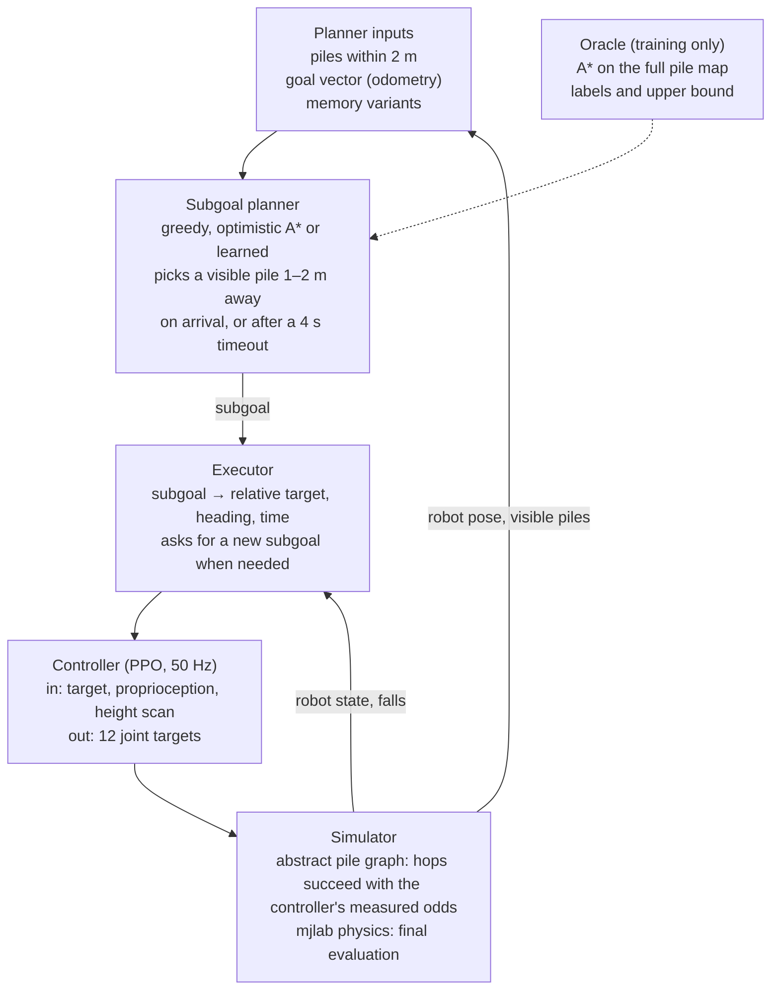

# Two-week plan: Subgoal planning under partial observability

October 4, 2026 · Damien Bardina

## Mission

A Go1 must reach a fixed goal 6 to 10 m away across a field of piles, seeing only about 2 m around itself. A subgoal planner picks the next pile to aim for from what it sees and remembers; a learned controller walks there. Some routes lead into dead ends that cannot be seen from the start.

**Research question.** How should a legged robot choose its subgoals when it can only see its surroundings, and how much does that cost compared with a planner that sees the whole field?

**Pitch.** Zhang et al. built a controller that reaches a given goal across risky stones. We ask who chooses that goal when the robot sees only 2 m, and how that choice avoids dead ends and loops.

**How it differs from Lab 1.** The lab trains a velocity-tracking Go1 with a height scan and tuned rewards on obstacle terrain. Here the learned controller is only the bottom layer. The research sits in the planning layer above it: partial observability, memory, loops and imitation of a privileged planner.

**What changed from the previous two-week draft.**

- Subgoal planning is back, as an explicit layer between the goal and the controller.
- Planners see only a local window. Full-map A\* appears only as a privileged oracle: the upper bound and the teacher for the learned planner.
- Teacher-student learning and memory move from the controller to the planner.
- The controller becomes a plain goal-reacher for short hops of 1 to 2 m, which lowers the locomotion risk.
- Planner work no longer waits for the controller: it starts on Day 1 in a fast abstract simulator without physics.

**What each member learns.**

| Member | Owns | Core skill learnt |
| --- | --- | --- |
| Amedeo | controller: terrain, curriculum, rewards, PPO | curriculum and reward design for legged RL |
| Tanmay | abstract simulator, classical planners, executor, evaluation | planning under partial observability, evaluation design |
| Damien | learned planner: privileged imitation, memory | imitation learning from a privileged expert, recurrent policies |

## Setup

Two layers run at different rates. The planner picks a subgoal, a visible pile 1 to 2 m away, whenever the robot reaches the previous one or runs out of time; the controller walks to the current subgoal at 50 Hz.

*Only the oracle sees the whole field, and only during training.* In the abstract simulator the executor and controller are replaced by a sampled hop outcome, so planners can be trained and compared long before the controller is ready.

**Episodes.** One start, one fixed goal 6 to 10 m away, and a time limit of about 60 s. A fresh goal is sampled every episode and stays fixed within it, so the planner cannot memorise one route. Evaluation uses a fixed benchmark list of (layout seed, start, goal) triples, so results are reproducible.

**The rule for observations.** Anything a deployed layer uses must be computable on a real robot from its own sensors and odometry. The full map is allowed only in the oracle, in rewards and in critics, none of which run at deployment.

| Information | Controller | Planner (deployed) | Oracle (training only) |
| --- | --- | --- | --- |
| Proprioception | yes | no | no |
| Current subgoal, relative to the robot | yes | not applicable | not applicable |
| Height scan, 1.6 × 1.2 m at 5 cm | yes | no | no |
| Piles within 2 m: position, height, size, slant | no | yes | yes |
| Goal position relative to the robot | no | yes | yes |
| Own memory: piles seen before, places visited | no | yes, in variants | not needed |
| Full pile map | no | no | yes |

**Perception assumption.** The planner's window comes from the simulator's pile list, filtered to 2 m. That equals a perfect pile detector on a 2 m height scan; state it in the report. Segmenting the height scan into piles is a stretch goal.

**Subgoal message.** `{x, y, heading}` in the odometry frame, always on a pile centre within 2 m. The executor turns it into the controller's command (relative position, heading error, time left). It asks the planner for a new subgoal when the robot is within 0.25 m of the current one or after a 4 s timeout; a fall ends the episode.

**Two simulators.**

1. **Abstract pile-graph simulator** for planner development. No physics: the robot hops from pile to pile, and each hop succeeds with a probability measured from the real controller (by gap, height difference and slant). It runs many thousands of episodes in minutes on a CPU.
2. **mjlab physics** for the final evaluation of every planner with the real controller.

## Terrain and curriculum (Amedeo)

The curriculum trains the controller, so difficulty rises in many small steps rather than a few big jumps. It ramps how hard each step is; how hard the route is to find is the planner's problem, tested on the moat and dead-end layouts.

**Pile parameters.** Starting guesses, to be calibrated on Day 4 from what the policy manages. Every parameter interpolates linearly over 20 difficulty rows.

| Dimension | Easiest row | Hardest row |
| --- | --- | --- |
| Pile top size | 50 cm | 12 cm |
| Gap between piles | 3 cm | 13 cm |
| Height variation | 0 cm | 8 cm |
| Top slant, random direction | 0° | 15° |
| Friction (randomised) | 0.8 to 1.2 | 0.5 to 1.2 |

**Path structure.** Four terrain types. The controller trains on the open and holes columns; the moat and dead-end layouts are for training and testing the planners:

| Type | What makes the route hard | Hardest row |
| --- | --- | --- |
| Open | nothing; every direction is walkable | locomotion only |
| Holes | random missing piles force small detours | 25% of piles missing |
| Moat | a band of missing piles with one crossing to the side | crossing up to 4 m off the straight line |
| Dead end | the straight line leads into a closed pocket | pocket up to 4 m deep |

The deepest moat and dead-end layouts place the escape route about twice as far away as the planner's 2 m window reaches, so it cannot be seen from the direct approach.

**How mjlab fits.** mjlab's curriculum mode gives each terrain type its own column, with a proportion setting that controls how many robots spawn on each type ([v1.3.0 release](https://github.com/mujocolab/mjlab/releases/tag/v1.3.0)). Use rows as difficulty. Promote a robot one row when it reaches its goal; demote it only when it covers less than a quarter of the distance to its target, following Zhang et al.'s relaxed demotion rule.

**Implementation check on Day 1.** Piles can be box geoms over a pit or a heightfield. Test which one mjlab's terrain generator and MuJoCo Warp handle well at the needed pile counts, and pick before writing the generator. Either way, the generator also writes each tile's pile list, which the planners, the oracle and the abstract simulator need.

**RQ1, curriculum.** Under the same training budget, compare the smooth 20-row curriculum with uniform sampling of all rows (no curriculum), 3 seeds each. If compute allows, add a coarse 5-row curriculum. This tests the teaching assistant's claim directly: how much behaviour a smooth ramp alone produces.

## Controller (Amedeo)

The controller only walks 1 to 2 m to a visible pile, which is exactly the setting where Zhang et al.'s goal-reaching formulation works. It never needs to know about dead ends; that is the planner's job.

**Starting point in mjlab.** mjlab ships a Go1 asset and demonstrated a Go1 velocity policy on its stair curriculum ([v1.3.0 release](https://github.com/mujocolab/mjlab/releases/tag/v1.3.0)), and its RayCastSensor with a grid pattern produces height maps ([sensor docs](https://mujocolab.github.io/mjlab/source/raycast_sensor.html)). Fork that task, replace the command and reward terms, and add the pile terrain. Check the environment with mjlab's zero-action and random-action agents before training ([README](https://github.com/mujocolab/mjlab)).

**Task.** Each target is a pile 1 to 2 m away, with a heading and a time budget. Targets are chained: on arrival a new one is sampled at once, as the planner will do, so switching subgoals is part of training.

**Observations.** Proprioception; target position relative to the robot, heading error as sin and cos, time left; height scan of 1.6 × 1.2 m at 5 cm. Base linear velocity goes to the critic; giving it to the actor is acceptable in simulation, but state it.

**Actions.** Joint position targets for the 12 joints, tracked by PD control at 50 Hz.

**Rewards.** Zhang et al.'s table, rescaled for the Go1:

| Term | Definition | When active |
| --- | --- | --- |
| Position tracking | 1 / (1 + distance²) to the target | last seconds of the time budget |
| Heading tracking | same form, for heading | near the target |
| Fall | large penalty | at the fall |
| Don't wait | penalises standing still far from the target | always |
| Move in direction | rewards velocity towards the target | first ~150 iterations only |
| Stand still | penalises motion once at the final target | final target only |
| Regularisers | joint velocity, action rate, torque, base and foot acceleration, thigh and shank collisions | always |

**Training.** MLP actor and critic, symmetry augmentation (the most important robustness component in Zhang et al.'s ablations), and the curriculum from the previous section. *Open question:* how many runs per day one H100 partition gives. Measure it on Day 1.

**Hand-off to the planners.** On Day 6, measure the frozen controller's hop success over a grid of hop length, gap, height difference and slant. That table calibrates the abstract simulator, so planners trained there face the controller's real weaknesses.

## Subgoal planners (Tanmay, Damien)

Four planners choose the next subgoal. Three see only the 2 m window and differ in what they remember and how they decide; the fourth sees everything and exists only for training and as the upper bound.

| Planner | Sees | Remembers | Decides by | Role | Owner |
| --- | --- | --- | --- | --- | --- |
| Oracle | whole field | nothing needed | A\* on the full pile graph | upper bound; teacher | Tanmay |
| Greedy | 2 m window | nothing | visible pile closest to the goal | baseline that should loop | Tanmay |
| Optimistic replanner | 2 m window | every pile seen so far | A\* over the seen map, unseen space assumed walkable | classical answer | Tanmay |
| Learned planner | 2 m window | memory variants | network scoring visible piles | ML contribution | Damien |

**Oracle.** Nodes are piles; an edge joins two piles when the controller can hop between them (gap and height difference within limits). A\* runs from the current pile to the goal, and the subgoal is the pile on the shortest path closest to 2 m ahead. It never runs at deployment.

**Greedy.** Among visible piles reachable from the current one, pick the one closest to the goal in a straight line. With no memory, it should loop in dead ends; that is why it is here.

**Optimistic replanner.** Keep a world-fixed map of every pile seen so far, built from odometry, and treat unseen space as walkable. At every replan, run A\* over this map and take the last seen pile on the path within 2 m. When a dead end is revealed, the plan changes. This is the free-space assumption behind D\* Lite (Koenig and Likhachev, 2002). With correct perception in a finite field it cannot circle forever, because every failed plan reveals new blocked space. Rerunning plain A\* each time is fast enough at this scale.

**Learned planner.**

1. Input: the visible piles as a set (relative position, height, size, slant, plus per-pile memory features) and the goal vector.
2. Network: a small MLP per pile, a pooled context vector, one score per pile. The subgoal is the highest-scoring pile, so outputs always land on real piles.
3. Privileged imitation (DAgger) in the abstract simulator: the learned planner drives, the oracle names its subgoal at every decision, and a cross-entropy loss teaches the planner to pick the visible pile nearest the oracle's choice.
4. Optional RL fine-tuning in the abstract simulator: policy gradient over pile choices, rewarded by progress along the oracle's walkable distance (privileged, training only) and a success bonus. It is cheap, because there is no physics.

**The imitation gap.** The oracle never explores: in front of a pocket it simply goes the right way, because it sees the exit. To the learned planner the same view sometimes means "go in" and sometimes "avoid", so it learns an average and may hesitate or loop. Memory and RL fine-tuning are the two remedies, compared in RQ3.

**RQ2, the price of partial observability (Tanmay).** With the same controller, how much success and path efficiency does seeing only 2 m cost, as a function of pocket depth? Compare oracle, optimistic replanner and greedy.

**RQ3, the learned planner (Damien).** Can a planner trained by imitating the oracle match or beat the optimistic replanner, and which memory and training does it need? The variants are in the next section.

## Memory and loops (Damien, Tanmay)

Loops are a planner problem. A planner without memory that faces the same view picks the same subgoal, so at a dead end it alternates between going in and coming out.

**Why loops happen.** The planner sends the robot into a pocket, sees pits ahead and picks a subgoal back out. Outside, the view again shows open piles towards the goal, so it picks the pocket again. Memory breaks the tie: "that pocket is closed" or "I have been there".

**Memory per planner.** Greedy has none and should loop. The optimistic replanner's map of seen piles is its memory: it remembers that the pocket is closed. The learned planner gets one of four variants:

| Variant | Memory | What it can remember |
| --- | --- | --- |
| L0 | none | nothing; should loop like greedy |
| L1 | GRU over its decisions | whatever helps, implicitly |
| L2 | visit count per visible pile | explicitly, where it has already been |
| L3 | GRU plus visit counts | both |

Each variant is trained with DAgger alone and with DAgger plus RL fine-tuning: 8 conditions × 3 seeds, all in the abstract simulator, so the whole grid needs no GPU training time.

**Visit counts.** Keep a 10 cm world grid filled from odometry only: add one to the cells under the robot and let old counts decay slowly. Each visible pile gets the count of its cells as an extra feature. A real robot could build this from its own odometry, and it is easy to plot.

**Do not add a plain revisit penalty** when fine-tuning. Escaping a dead end requires walking back over visited ground, so penalising revisits punishes the escape. Progress along the oracle's walkable distance already rewards leaving the pocket.

**Loop metrics.**

| Metric | Definition |
| --- | --- |
| Repeat-subgoal fraction | share of subgoals placed on piles already chosen earlier in the episode |
| Loop event | the same pile chosen as subgoal three times in one episode |
| Stuck episode | a timeout with at least one loop event |
| Dead-end escape rate | of the episodes that enter a pocket, the share that leave it and reach the goal |
| Success versus pocket depth | success at pocket depths of 0.5, 1, 1.5 and 2 times the 2 m window |

**The key figure.** Success against pocket depth divided by window size, one line per planner. Expected: greedy and L0 collapse once the pocket is deeper than the window; the optimistic replanner keeps succeeding but walks further. Whether a learned planner with memory matches it with shorter paths is the open question.

## Evaluation

Every planner is tested twice: on many episodes in the abstract simulator, and on a smaller paired set in mjlab with the real controller. The physics result is the one that counts; the gap between the two is itself a finding.

**Benchmark sets.**

- **Locomotion set** (RQ1): open terrain at every curriculum row, with chained 1 to 2 m targets.
- **Navigation set** (RQ2, RQ3): holes, moat and dead-end layouts at one moderate locomotion row (for example row 10 of 20), with pocket depths of 0.5, 1, 1.5 and 2 times the window.
- **Unseen set** (if time allows): slants beyond the training range and pocket shapes never used in training, such as L-shaped or double pockets.

**Metrics.** Success, fall and timeout rates; time to goal; path efficiency (walked distance divided by the oracle's path length); number of replans; and the loop metrics from the previous section.

**Experiments.**

| Question | Comparison | Runs | Owner |
| --- | --- | --- | --- |
| RQ1 Curriculum | smooth 20-row curriculum versus uniform sampling, for the controller | 2 conditions × 3 seeds of PPO | Amedeo |
| RQ2 Price of partial observability | oracle, optimistic replanner, greedy; same controller | evaluation only | Tanmay |
| RQ3 Learned planner | memory variants L0 to L3, DAgger with and without RL fine-tuning, against the optimistic replanner | 8 conditions × 3 seeds in the abstract simulator; the best two in physics | Damien |

**One controller for every planner.** The smooth-curriculum seed-0 controller drives every physics evaluation, so planner comparisons are not confounded by controller differences. Controller seed variation is reported in RQ1.

**Compute.** Only RQ1 needs heavy GPU training (six PPO runs). Planners train in the abstract simulator, and physics is used for evaluation only.

**Statistics.** Three seeds per trained condition and at least 200 physics episodes per planner and terrain type. Every condition uses the same layout seeds, so comparisons are paired. Report the mean and standard deviation across seeds, and Wilson 95% intervals for pooled success rates.

**Grade mapping.** Grade-C foundation: controller plus greedy and optimistic planners evaluated end to end in physics with 3 seeds, plus RQ1. Grade-A contributions: the curriculum analysis (Amedeo), RQ2 (Tanmay), RQ3 (Damien).

## Roadmap

Ten working days in four phases. Planner work starts on Day 1 in the abstract simulator and never waits for the controller; the two meet at the Day-6 freeze.

| Phase | Amedeo (controller, terrain, curriculum) | Damien (learned planner, memory) | Tanmay (simulator, planners, evaluation) |
| --- | --- | --- | --- |
| **Days 1–3** · Build every piece on its own | D1: mjlab smoke test, Go1 asset, measure runs per day. D2–3: pile generator, goal environment, first PPO runs on open piles. | D1–2: controller training setup with Amedeo (symmetry, chaining). D3: planner network and DAgger loop in the abstract simulator. | D1: interface and benchmark spec (all). D1–3: abstract pile simulator; oracle, greedy and optimistic A\*; loop metrics. |
| **G1 · Day 3** | Controller reaches 1–2 m targets on open piles; classical planners run in abstraction. *No-go:* wider piles and no slant; planner work is unaffected. | | |
| **Days 4–6** · Train the controller and the planners in parallel | D4: launch RQ1, smooth vs. uniform curriculum, 3 seeds. Calibrate rows, tune rewards. | DAgger for L0 to L3, 3 seeds. RL fine-tuning of pile choices. Imitation-gap trajectory plots. | RQ2 in the abstract simulator. Executor in mjlab. D6: hop-success table from the frozen controller. |
| **G2 · Day 6** | Controller frozen (smooth curriculum, seed 0); abstract simulator calibrated with its hop odds. **Everything after Day 6 relies on this freeze.** | | |
| **Days 7–8** · Physics evaluation | RQ1: evaluate all 6 runs on the locomotion set; videos. | Retrain best variants on the calibrated simulator; physics runs with Tanmay (RQ3). | All planners on the physics navigation set; loop metrics; depth curve (RQ2). |
| **G3 · Day 8** | Feature freeze; every figure generated from logged runs. | | |
| **Days 9–10** · Write up and present | Report: controller, curriculum, RQ1 results. | Report: learned planner, RQ3 results. | Report: planners, RQ2; slides. Rehearsal with questions (all). |
| **Day 10** | Report, code and presentation submitted. | | |

The hop-success table measured on Day 6 is the hand-off: it makes the abstract simulator fail where the real controller fails, before any planner runs in physics.

## Risks and cuts

The split into two layers is itself the main de-risking: if the controller struggles, RQ2 and RQ3 still produce results in the abstract simulator.

| Risk | Early warning | Response |
| --- | --- | --- |
| Controller cannot hop reliably on hard piles | not reaching 1 to 2 m targets on open piles by Day 3 | freeze it on Day 6 anyway and run the navigation set at the hardest row it masters |
| Abstract simulator is too optimistic | oracle success in physics far below its abstract success | calibrate hop success from the frozen controller; report the remaining gap as a finding |
| Planner subgoals the controller cannot execute, such as sharp turns | timeouts cluster on turning hops | restrict candidates to piles within 90° of the robot's heading, or add turning targets to controller training |
| Learned planner imitates poorly | DAgger accuracy plateaus early | richer per-pile features, or a small CNN on a rasterised window; report the imitation gap |
| Simulation too slow with many piles | Day-1 smoke test | heightfield piles, fewer tiles, fewer parallel robots |

**Cut order if time or compute runs short.** Cut from the top:

1. L3 and the unseen benchmark set.
2. RL fine-tuning of the learned planner (RQ3 becomes DAgger with memory variants).
3. The coarse 5-row curriculum in RQ1.
4. Physics evaluation of more than one learned planner.
5. If the controller fails entirely: run RQ2 and RQ3 in the abstract simulator only, and show physics on easy piles as a demonstration.

## Reading list and sources

One or two papers per person before Day 3 is enough; each maps to one section of this plan.

| Paper | Why it matters here | Reader |
| --- | --- | --- |
| [Zhang et al., Learning Agile Locomotion on Risky Terrains, IROS 2024](https://arxiv.org/html/2311.10484v2) | the goal-reaching controller, its curriculum and rewards | all |
| Rudin et al., Advanced Skills by Learning Locomotion and Local Navigation End-to-End, IROS 2022 | the end-to-end alternative to our two layers | Amedeo |
| Hoeller et al., ANYmal Parkour: Learning Agile Navigation for Quadrupedal Robots, Science Robotics 2024 | a learned navigation layer on top of low-level skills | Tanmay, Damien |
| Koenig and Likhachev, D\* Lite, AAAI 2002 | replanning under the free-space assumption | Tanmay |
| Ross et al., A Reduction of Imitation Learning and Structured Prediction to No-Regret Online Learning (DAgger), AISTATS 2011 | why the learned planner must drive during imitation | Damien |
| Weihs et al., Bridging the Imitation Gap by Adaptive Insubordination, NeurIPS 2021 | the imitation gap and how to close it | Damien |

The Rudin and Hoeller papers are cited in Zhang et al.'s reference list. The others are standard references quoted from memory, so check exact titles before citing them in the report.

**Pages used for this plan.**

- [mjlab repository and README](https://github.com/mujocolab/mjlab)
- [mjlab v1.3.0 release notes: terrain presets and curriculum columns, Go1 stair policy](https://github.com/mujocolab/mjlab/releases/tag/v1.3.0)
- [mjlab RayCast sensor documentation](https://mujocolab.github.io/mjlab/source/raycast_sensor.html)
- [rsl_rl repository](https://github.com/leggedrobotics/rsl_rl)
